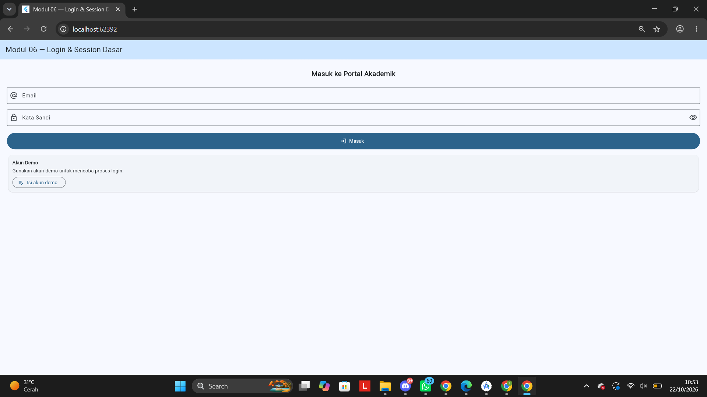
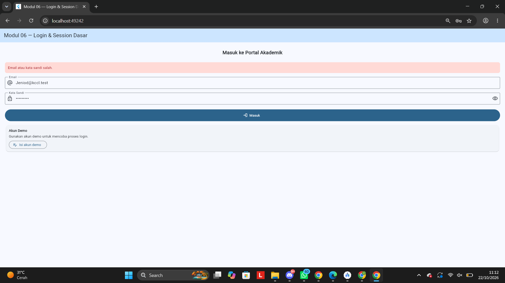
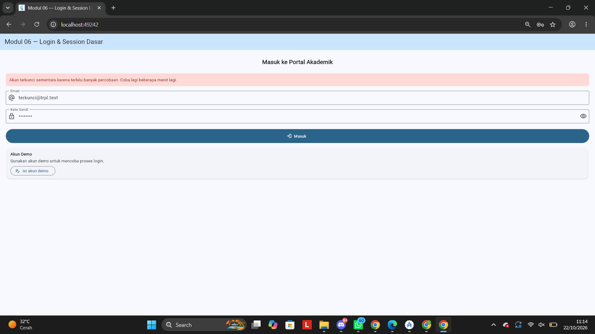
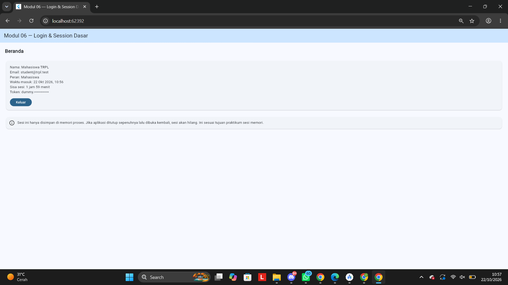
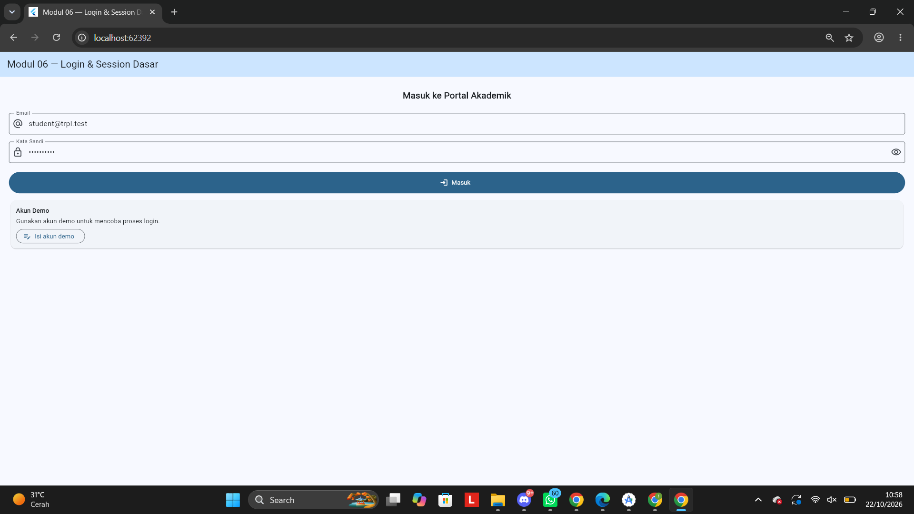
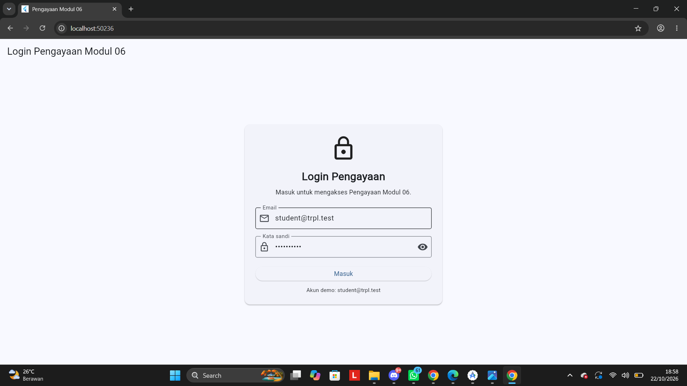
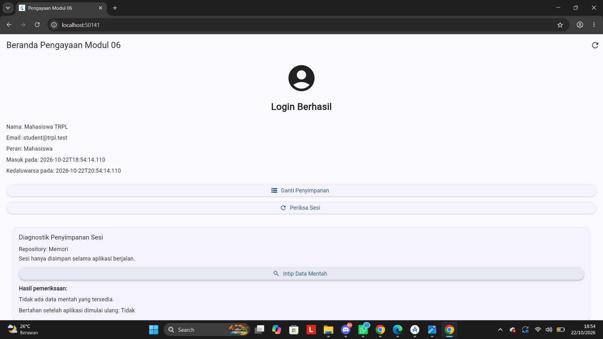
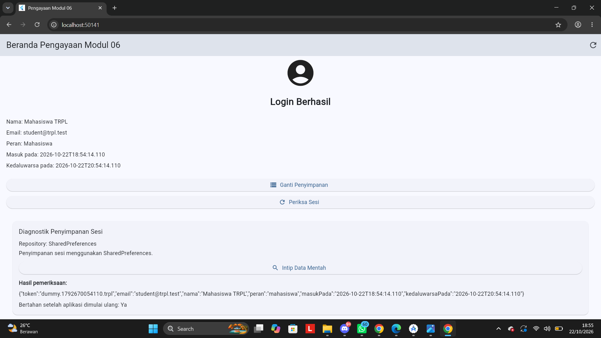
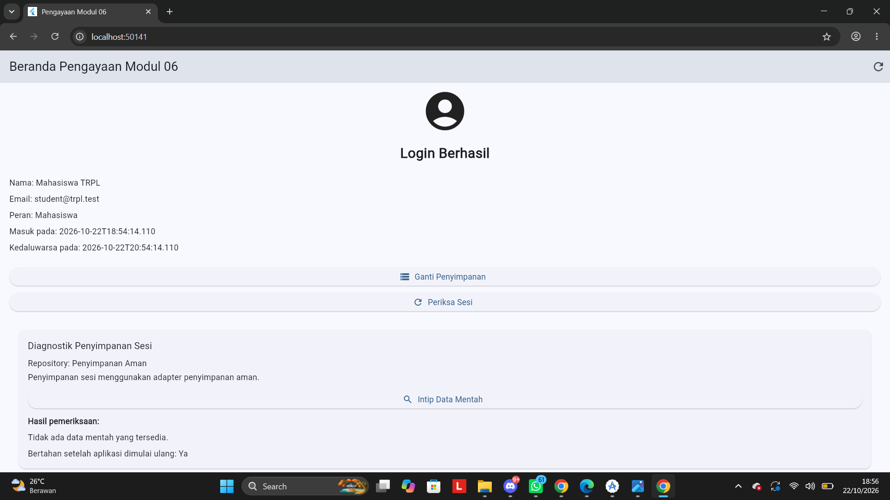

# Modul 06 — Login dan Session Dasar

## Identitas Mahasiswa

| Keterangan | Detail |
|---|---|
| **Nama** | Jeni Kamayanti |
| **NIM** | 362558302004 |
| **Kelas / Angkatan** | TRPL 2E / 2025 |
| **Dosen Pengampu** | Sepyan Purnama Kristanto, M.Kom. |
| **Mata Kuliah** | Pemrograman Perangkat Bergerak |

## Deskripsi

Pada Modul 06 ini, saya belajar membuat fitur login dan session menggunakan Flutter. Saya melakukan pengujian login gagal, akun terkunci, login berhasil, dan logout. Pada bagian pengayaan, saya juga mempelajari beberapa cara penyimpanan session.

## Fase A — Fundamental

### Pengujian Halaman Login

Saya mencoba membuka halaman login untuk melihat tampilan awal aplikasi sebelum pengguna masuk. Pada halaman ini, pengguna dapat memasukkan email dan password.



### Pengujian Login Gagal

Saya mencoba memasukkan email atau password yang salah. Aplikasi menampilkan pesan bahwa login gagal sehingga pengguna mengetahui bahwa data yang dimasukkan belum benar.



### Pengujian Akun Terkunci

Saya juga mencoba fitur akun terkunci untuk melihat bagaimana aplikasi menangani percobaan login yang gagal. Ketika batas percobaan yang ditentukan aplikasi tercapai, akun akan dikunci sesuai aturan yang diterapkan.



### Pengujian Login Berhasil

Saya mencoba login menggunakan akun yang benar. Setelah proses login berhasil, aplikasi menampilkan halaman utama.



### Pengujian Logout

Saya mencoba fitur logout untuk memastikan pengguna dapat keluar dari halaman utama dan kembali ke halaman login.



## Fase B — Pengayaan

Pada fase pengayaan, saya mencoba fitur login dan session serta mempelajari beberapa metode penyimpanan session yang tersedia pada aplikasi.

### Pengujian Halaman Login Pengayaan

Saya membuka halaman login pengayaan untuk mencoba fitur login pada bagian ini.



### Pengujian Session Pengayaan

Setelah login berhasil, saya memeriksa halaman session untuk melihat kondisi pengguna setelah masuk ke aplikasi.


### Pengujian Session dengan Memori

Saya mencoba penyimpanan session menggunakan memori aplikasi. Data session disimpan sementara di memori sesuai dengan implementasi yang dibuat.



### Pengujian Session dengan Shared Preferences

Saya mencoba menyimpan session menggunakan Shared Preferences untuk mempelajari cara menyimpan data pada aplikasi Flutter.



### Pengujian Session dengan Penyimpanan Aman

Saya mencoba penyimpanan session menggunakan penyimpanan aman untuk mempelajari cara menyimpan data yang bersifat sensitif.



## Cara Menjalankan Aplikasi

Buka terminal pada folder project, kemudian jalankan perintah berikut.

### Fase A — Fundamental

```bash
flutter run -t lib/main.dart
```

### Fase B — Pengayaan

```bash
flutter run -t lib/main_pengayaan.dart
```

Untuk memeriksa kode dan menjalankan pengujian, gunakan perintah berikut.

```bash
flutter analyze
flutter test
```

## Kesimpulan

Dari praktikum Modul 06 ini, saya belajar membuat fitur login dan session pada Flutter. Saya juga belajar menangani login gagal, akun terkunci, login berhasil, dan logout. Pada bagian pengayaan, saya mencoba penyimpanan session menggunakan memori, Shared Preferences, dan penyimpanan aman. Dengan praktikum ini, saya menjadi lebih memahami cara kerja login dan session pada aplikasi Flutter.
