# Dokumentasi Praktikum Pemrograman Perangkat Bergerak

Repository ini berisi hasil pengerjaan praktikum mata kuliah **Pemrograman Perangkat Bergerak** menggunakan Flutter.

## Identitas Mahasiswa

| Keterangan | Detail |
|---|---|
| Nama | Jeni Kamayanti |
| NIM | 362558302004 |
| Kelas | TRPL 2E |
| Angkatan | 2025 |
| Dosen Pengampu | Sepyan Purnama Kristanto, M.Kom. |
| Mata Kuliah | Pemrograman Perangkat Bergerak |

---

# Modul 06 — Login dan Session

## Deskripsi

Pada Modul 06, saya mempraktikkan pembuatan fitur login dan pengelolaan session menggunakan Flutter. Praktikum ini mencakup beberapa kondisi login, seperti login gagal, akun terkunci, login berhasil, dan logout.

Pada bagian pengayaan, saya juga mencoba beberapa metode penyimpanan session, yaitu menggunakan memori, Shared Preferences, dan penyimpanan aman.

## Fase A — Fundamental

### 1. Halaman Login

Halaman login merupakan tampilan awal sebelum pengguna masuk ke aplikasi.

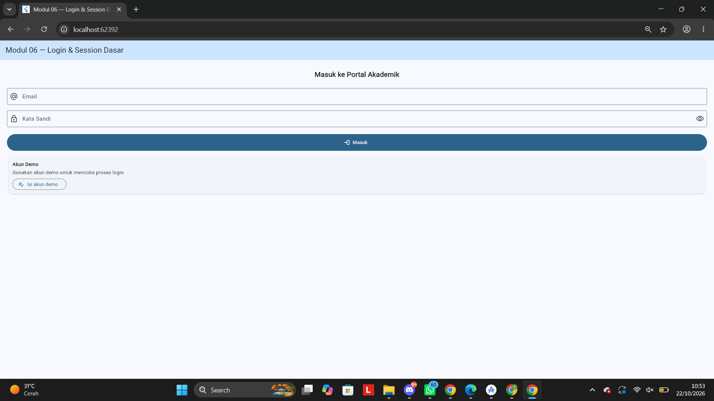

### 2. Login Gagal

Pengujian dilakukan dengan memasukkan data login yang tidak sesuai. Aplikasi menampilkan pesan bahwa proses login gagal.

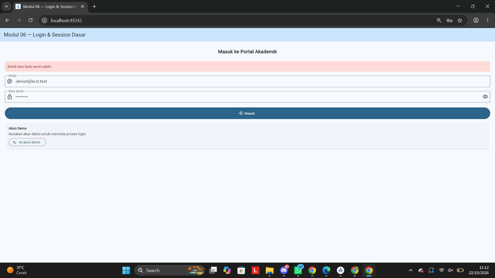

### 3. Akun Terkunci

Pengujian dilakukan untuk melihat respons aplikasi ketika batas percobaan login gagal telah tercapai.

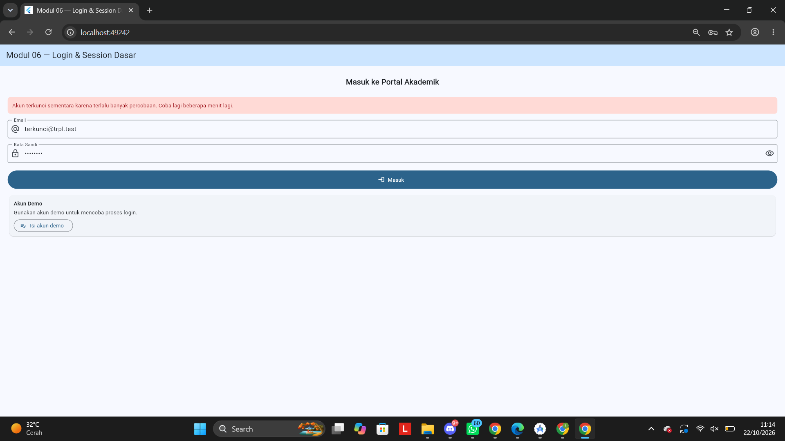

### 4. Login Berhasil

Setelah memasukkan data akun yang benar, pengguna berhasil masuk ke halaman utama aplikasi.

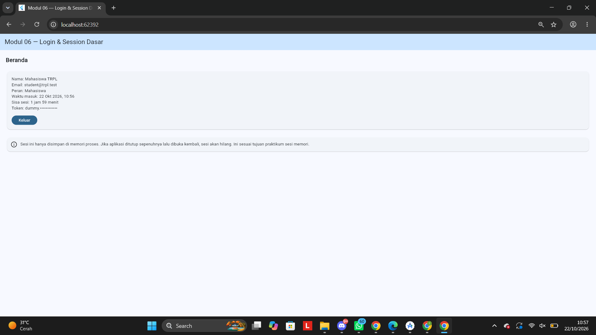

### 5. Logout

Fitur logout digunakan untuk mengakhiri session dan mengembalikan pengguna ke halaman login.

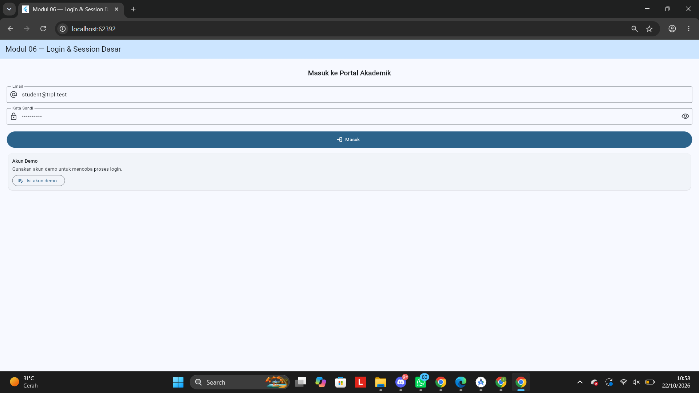

## Fase B — Pengayaan

Pada fase ini, saya mencoba penerapan session dengan beberapa metode penyimpanan.

### 1. Halaman Login Pengayaan

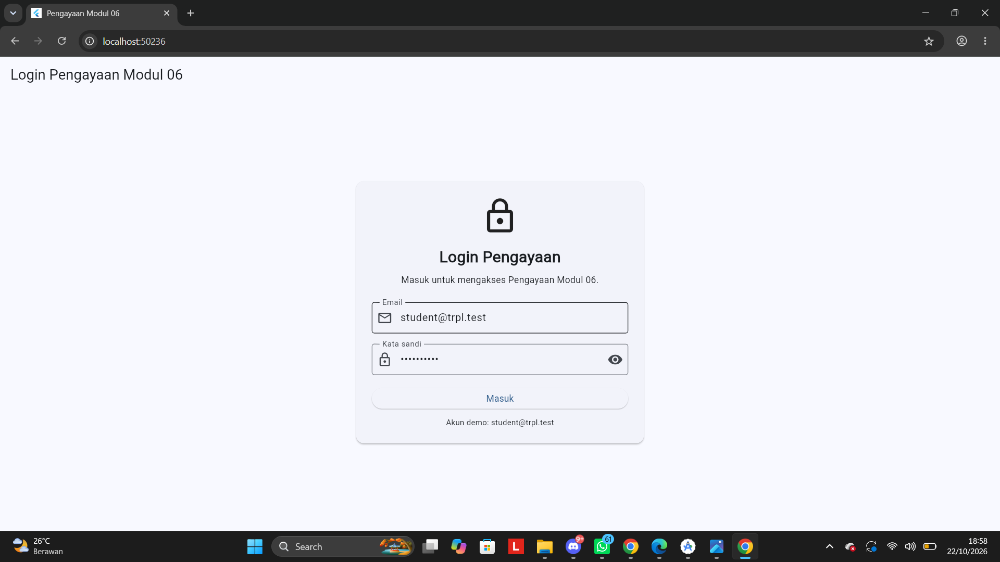

### 2. Penyimpanan Session di Memori

Penyimpanan session menggunakan memori bersifat sementara selama aplikasi berjalan.

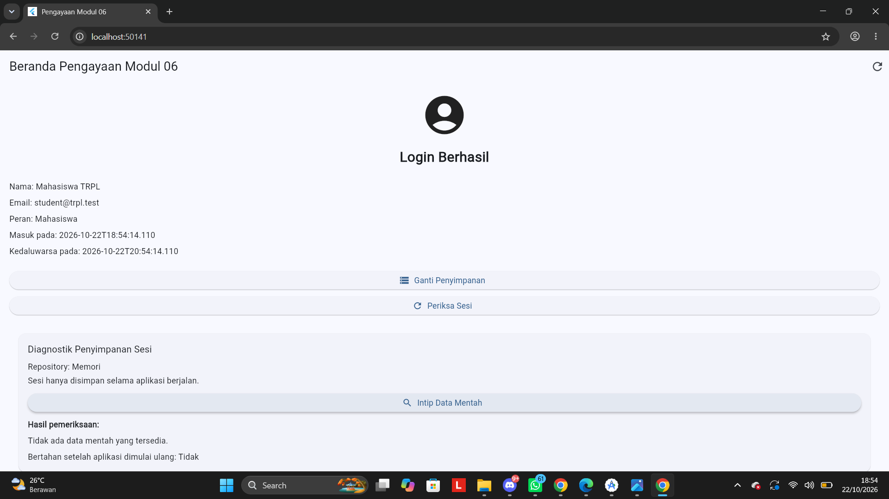

### 3. Penyimpanan Session dengan Shared Preferences

Shared Preferences digunakan untuk mempelajari penyimpanan data sederhana pada aplikasi Flutter.

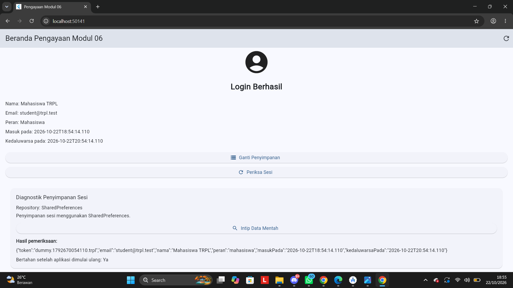

### 4. Penyimpanan Session Aman

Pada bagian ini, saya mencoba metode penyimpanan aman untuk data session.

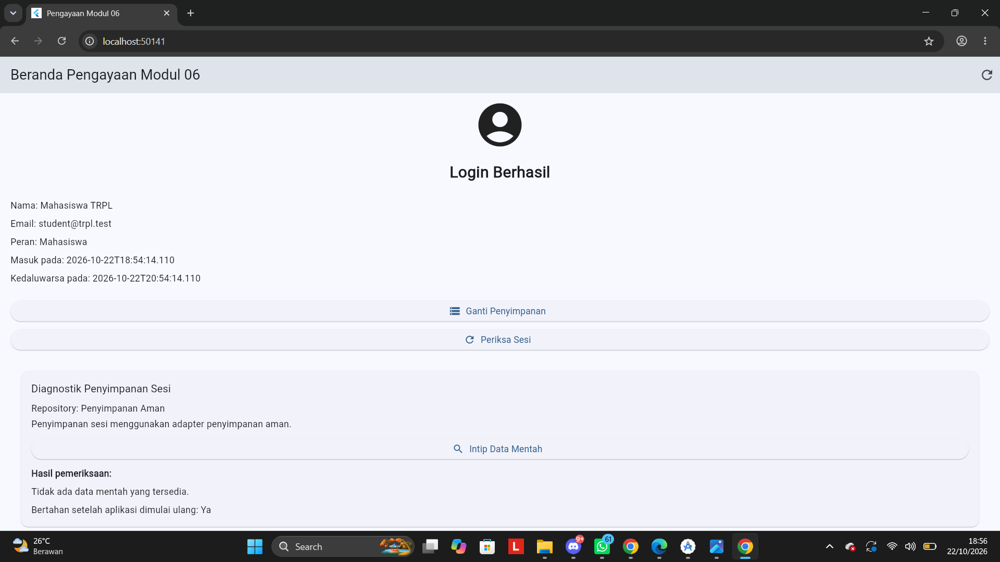

## Menjalankan Modul 06

Jalankan perintah berikut dari direktori utama project.

**Fase A — Fundamental**

```bash
flutter run -t lib/main.dart
```

**Fase B — Pengayaan**

```bash
flutter run -t lib/main_pengayaan.dart
```

---

# Modul 11 — Performance Optimization

## Deskripsi

Pada Modul 11, saya mempelajari cara mengoptimalkan tampilan daftar dengan jumlah data yang banyak. Aplikasi yang dibuat menampilkan 1.000 data tugas dengan fitur pencarian dan filter berdasarkan status tugas.

Dalam praktikum ini, saya menggunakan `ListView.builder` agar item daftar dibuat sesuai kebutuhan tampilan, sehingga tidak semua kartu harus dibuat sekaligus.

## Fitur Aplikasi

- Menampilkan 1.000 data tugas.
- Menampilkan tugas yang masih aktif.
- Menampilkan tugas yang sudah selesai.
- Mencari tugas berdasarkan kata kunci.
- Menggunakan `ListView.builder` untuk menampilkan daftar secara lebih efisien.

## Fase A — Tampilan dan Fitur

### 1. Menampilkan Semua Tugas

Pada tampilan awal, aplikasi menampilkan 1.000 dari 1.000 tugas.

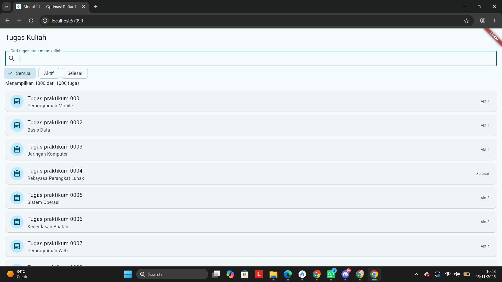

### 2. Filter Aktif

Filter Aktif digunakan untuk menampilkan tugas yang belum selesai. Jumlah tugas yang ditampilkan adalah 750.

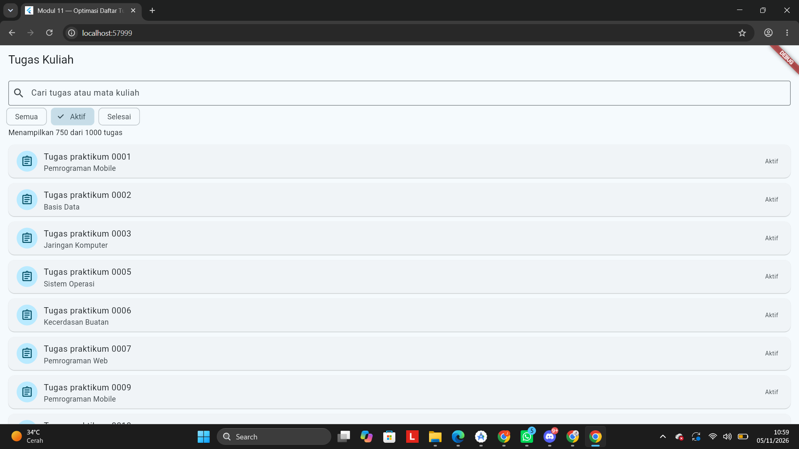

### 3. Filter Selesai

Filter Selesai digunakan untuk menampilkan tugas yang sudah selesai. Jumlah tugas yang ditampilkan adalah 250.


### 4. Pencarian Tugas

Saya mencoba pencarian menggunakan kata kunci `tugas praktikum 0002`. Aplikasi menampilkan tugas yang sesuai dengan kata kunci tersebut.

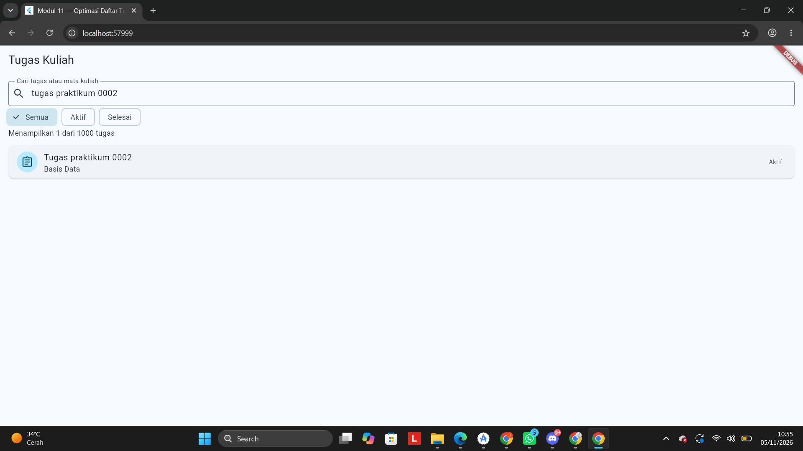

## Fase B — Pengujian dan Analisis

### 1. Widget Test

Widget test dilakukan untuk memeriksa beberapa fungsi aplikasi, yaitu:

- Memastikan daftar menggunakan builder dan tidak membuat 1.000 kartu sekaligus.
- Memastikan pencarian membatasi hasil tanpa mengubah sumber data.
- Memastikan filter Selesai hanya menampilkan tugas yang sudah selesai.

Perintah untuk menjalankan pengujian:

```bash
flutter test test/modul_11_test.dart
```

Hasil pengujian:

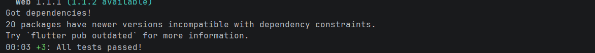

### 2. Flutter Analyze

Flutter Analyze digunakan untuk memeriksa apakah terdapat masalah pada kode yang dibuat.

Perintah yang digunakan:

```bash
flutter analyze lib/modul_11/modul_11_app.dart test/modul_11_test.dart
```

Hasil analisis:

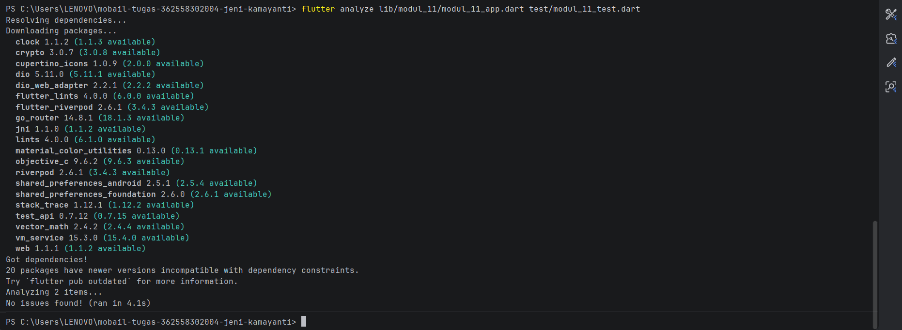

## Menjalankan Modul 11

Untuk menjalankan aplikasi:

```bash
flutter pub get
flutter run
```

Untuk menjalankan widget test Modul 11:

```bash
flutter test test/modul_11_test.dart
```

Untuk melakukan analisis kode Modul 11:

```bash
flutter analyze lib/modul_11/modul_11_app.dart test/modul_11_test.dart
```

## Kesimpulan Modul 11

Dari praktikum ini, saya belajar menggunakan `ListView.builder` untuk menampilkan data dalam jumlah banyak secara lebih efisien. Saya juga mempraktikkan fitur pencarian dan filter status pada daftar tugas.

Selain itu, saya menjalankan widget test untuk memeriksa fungsi daftar, pencarian, dan filter agar berjalan sesuai dengan skenario pengujian.

---

# Struktur Folder

Berikut gambaran struktur folder dokumentasi project:

```text
project/
├── lib/
│   ├── modul_06/
│   ├── modul_11/
│   ├── pengayaan/
│   └── main.dart
├── test/
│   └── modul_11_test.dart
├── screenshots/
│   ├── 01_all_tasks.png
│   ├── 02_active_filter.png
│   ├── 03_completed_filter.png
│   ├── 04_search_task.png
│   ├── 05_test_passed.png
│   ├── 06_flutter_analyze.png
│   ├── akun-terkunci.png
│   ├── beranda.png
│   ├── login.png
│   ├── login-gagal.png
│   ├── login-pengayaan.png
│   ├── logout.png
│   ├── session-memori.png
│   ├── session-penyimpanan-aman.png
│   └── session-shared-preferences.png
├── pubspec.yaml
└── README.md
```


**Hak Cipta © 2026 Jurusan Bisnis dan Informatika (JBI), Politeknik Negeri Banyuwangi.**